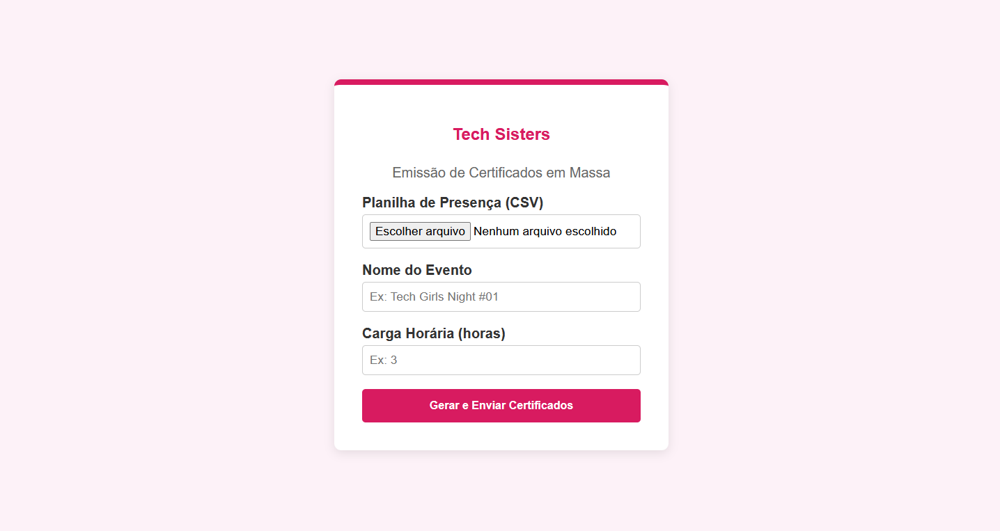
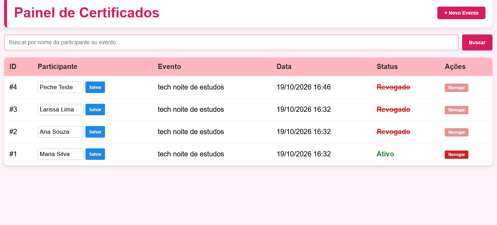
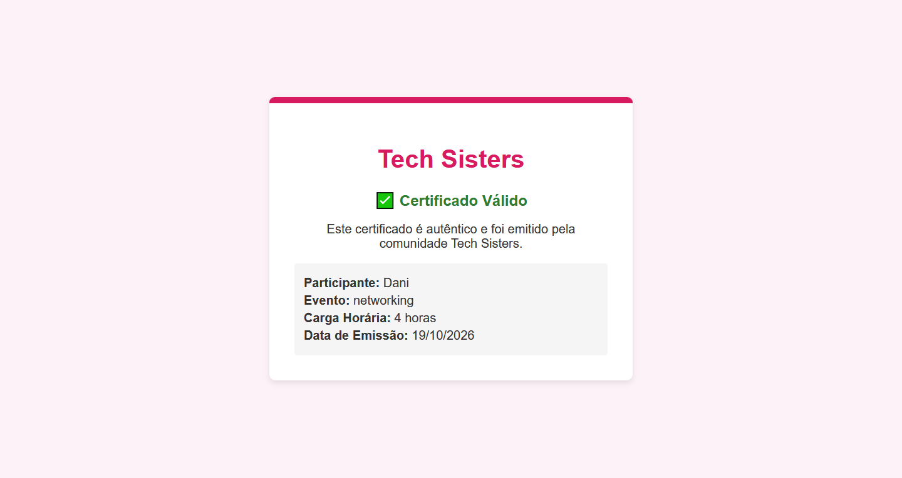

# Tech Sisters - Automação de Certificados

Uma solução completa em Python para automatizar a emissão, o envio, a validação e o gerenciamento de certificados dos eventos da comunidade Tech Sisters.


---

## Demonstração do Sistema

| Painel Administrativo | Dashboard de Gerenciamento |
| :---: | :---: |
|  |  |
| *Interface amigável para upload de CSV e configuração do evento.* | *Painel com busca, edição rápida e revogação de certificados.* |

| Certificado Gerado (PDF) | Página Pública de Validação |
| :---: | :---: |
|  |  |
| *Certificado gerado dinamicamente com QR Code e campo de parceria.* | *Validação pública com mascaramento de dados (LGPD).* |

---

## "01" - Sobre o projeto

O **Tech Sisters - Automação de Certificados** moderniza o fluxo de emissão de certificados da comunidade, reduzindo tarefas manuais e garantindo segurança na validação. 

O sistema resolve gargalos operacionais, como a emissão em lote, a padronização visual flexível (permitindo mudar o layout sem alterar o código) e a proteção dos dados das participantes.

## "02" - Funcionalidades Principais

- **Geração em Lote:** Leitura de planilhas (CSV) do Google Forms e geração automatizada de PDFs.
- **Design Flexível:** Templates em HTML/CSS. O layout inclui um campo dinâmico de "Realização / Parceria", adaptando-se a eventos conjuntos.
- **Envio Automatizado:** Disparo de e-mails personalizados com o certificado em anexo.
- **QR Code de Validação:** Cada certificado possui um código único criptográfico.
- **Painel Administrativo (`/admin`):** Interface protegida por senha para emissão em massa.
- **Dashboard (`/dashboard`):** Visualização de todos os certificados, com busca por nome/evento, edição em linha e revogação.
- **Validação Pública:** Página de verificação acessível via QR Code.

## "03" - Segurança e LGPD

A arquitetura foi pensada para proteger os dados das participantes:

- **Tokens Criptográficos:** O sistema gera um token aleatório de 256 bits (via `secrets`). O banco de dados armazena apenas o hash SHA-256 desse token, nunca o valor real.
- **Privacidade (LGPD):** A página pública de validação exibe apenas o primeiro nome e a inicial do sobrenome da participante (ex: "Maria S.").
- **Proteção de Rotas:** As rotas de administração utilizam HTTP Basic Auth (usuário e senha no `.env`).
- **Revogação:** Certificados podem ser revogados. Se o QR Code for escaneado, a página indicará que o documento é inválido.

## "04" - Tecnologias Utilizadas

| Tecnologia | Aplicação |
| :--- | :--- |
| **Python** | Linguagem principal do backend. |
| **FastAPI** | Framework web para construção da API. |
| **Jinja2** | Renderização dos templates HTML. |
| **WeasyPrint** | Conversão de HTML/CSS em PDFs de alta qualidade. |
| **SQLAlchemy + SQLite** | ORM e banco de dados (pronto para PostgreSQL). |
| **qrcode + Pillow** | Geração de QR Codes. |
| **Pandas** | Leitura de planilhas CSV. |
| **smtplib** | Envio de e-mails. |

## "05" - Como executar o projeto localmente

1. Clone o repositório:
```bash
git clone https://github.com/Pechebiloski/TechSister-Certificados.git
cd TechSister-Certificados
Crie e ative um ambiente virtual:

bash
python -m venv venv
source venv/bin/activate  # Linux/Mac
# venv\Scripts\activate   # Windows
Instale as dependências:

bash
pip install -r requirements.txt
Instale as dependências do sistema (necessárias para o WeasyPrint):

bash
sudo apt-get update && sudo apt-get install -y libpango-1.0-0 libharfbuzz0b libpangoft2-1.0-0 libgdk-pixbuf2.0-0
Configure o .env (use o .env.example como base):

bash
cp .env.example .env
Inicie o servidor:

bash
uvicorn app.main:app --reload
Acesse http://127.0.0.1:8000/admin para a interface de emissão.

"06" - Roadmap
☑ Estrutura inicial e modelagem do banco de dados.
☑ Geração de PDF individual e em massa (ZIP).
☑ Integração com WeasyPrint e design customizado.
☑ Página de validação pública via QR Code (com LGPD).
☑ Disparo de e-mail com anexo.
☑ Implementação de segurança (Hash SHA-256, Basic Auth).
☑ Dashboard com busca, edição e revogação.
□ Deploy em nuvem (Render/Railway).
□ Integração direta com API do Google Sheets.